<code>● the quiet room · 3 residents online · <a href="https://your-quiet-room.vercel.app/">enter the room ↗</a></code>

  

<code>engineer · designer · occasional shitposter</code>

  

 

### the quiet room &nbsp;<code>01</code>

most of the interesting work happens in the gap between what an agent *can* do and what it *should* do.

i build in that gap.

systems that intercept, classify, and hold, then wait for a human before the irreversible thing happens. tools that tell you exactly what's on the other side of a port before you touch it. interfaces that feel deliberate instead of generated.

 

### try the gate &nbsp;<code>02</code>

~~~diff
  agent>    DROP TABLE users;
  backstop: destructive write detected. classifying…
- risk:     irreversible · scope: production
  backstop: holding. waiting for a human.
+ human:    hold.
+ backstop: the table lives another day.
~~~

 

### currently shipping &nbsp;<code>03</code>

<table>
<tr>
<td width="50%" valign="top">

**[backstop](https://github.com/pratyush2514/Backstop)** 
<code>go · postgres · ast</code>

last line of defense between an ai agent and production postgres. ast risk classification, human gates on destructive writes, snapshot recovery when something still gets through.

</td>
<td width="50%" valign="top">

**[portopsy](https://github.com/pratyush2514/portopsy)** 
<code>rust · cli</code>

answers "who actually owns this port?" with process trees, working directories, and cgroups. read-only by design.

</td>
</tr>
<tr>
<td width="50%" valign="top">

**[clean-my-data](https://github.com/pratyush2514/Clean-My-Data)** 
<code>python · data</code>

turns noisy csvs into stats, charts, and reports without the usual spreadsheet archaeology.

</td>
<td width="50%" valign="top">

**pulseboard** 
<code>realtime · slack</code>

real-time slack sentiment and tension surface. shipped at wednesday solutions.

</td>
</tr>
</table>

 

### the tools &nbsp;<code>04</code>

languages 
`java` `typescript` `python` `go` `rust`

frameworks 
`spring boot` `react` `next.js` `node.js`

infra 
`postgresql` `docker` `aws` `linux`

 

### signal &nbsp;<code>05</code>

 

### elsewhere &nbsp;<code>06</code>

on [x](https://x.com/Pratyusshmd) you'll find the other half: the design notes, the early-morning drives, the moments where the model does something unexpectedly correct, and the occasional post that doesn't try to sound like a product update.

 

<code>the cat is still on the keyboard.</code>

[portfolio](https://pratyush-dev-one.vercel.app/) · [x](https://x.com/Pratyusshmd) · [linkedin](https://linkedin.com/in/pratyushrastogi05)

